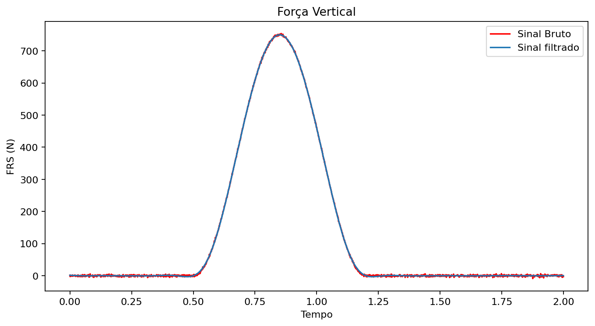

# Biomechanics signal processing

Educational Python notebooks by Vítor Cimonetti for examining biological and movement signals.



## Run

```bash
cd biomechanics-signal-processing
python -m pip install -r requirements.txt
cd notebooks
jupyter lab
```

Open a notebook and execute its cells in their original order. The accompanying TXT/CSV files are synthetic substitutes, with the names expected by the original input-loading cells. See `notebooks/DADOS_SINTETICOS.md` for formats and sampling rates. In `FIltragem.ipynb`, answer `1000` and `s` when prompted. The smoothing notebook retains its original dependency-installation command and full span sweep. Output filenames and save locations follow the original code.

| Notebook | Focus |
| --- | --- |
| Análise_espectral.ipynb | Original FFT-based spectral routine |
| FIltragem.ipynb | Spectral analysis, filter residuals and vertical force filtering |
| TAREFA_5_ Filtragem dos Sinais Biológicos.ipynb | Original filtering exercise, unchanged source cells |
| Função_para_suavização_de_sinais_cinemáticos.ipynb | Robust LOESS and finite-difference derivatives |
| Calculo_anguloRelativo_joelho(20261012-234937).ipynb | Loop-based geometric knee angle and cycle extrema |

## Methods retained

The FFT routines retain their original spectrum scaling and numerical integration or cumulative-sum methods. The integrated quantity named `forca_total` is a spectral index under that scaling, not physical force or a correctly scaled variance in input-unit squared. The first two routines remove the mean; the exercise retains DC. Their frequency results therefore need not agree. The original first-two spectrum routines omit the Nyquist bin. Frequency quantiles remain selected by bins, without interpolation.

Butterworth filters retain `b, a` coefficients, fourth-order single-pass design and `filtfilt`. Forward-backward filtering squares the magnitude response. Design cutoffs are not compensated for the final -3 dB point. Very small cutoffs can be numerically sensitive; boundary effects and record length need inspection. The residual curve remains a manual exploration tool.

Robust LOESS retains `family='symmetric'`, its span sweep and the original `np.diff` derivatives using `freq_aquis`. Span is a fraction of observations, not seconds. The data must be sampled uniformly at that frequency. Velocity and acceleration have one and two fewer samples than position, as in the original code.

The knee angle is the included angle between hip-knee and ankle-knee vectors (180° at extension), not a Cardan angle. The cycle detector retains its 150-sample spacing threshold. Adapt this explicitly when sampling rate or cadence changes.

## Credits and tests

Notebooks by Vítor Cimonetti. AI assistance was used for targeted corrections and portfolio preparation.

Run the regression tests from `biomechanics-signal-processing/`:

```bash
python -m unittest discover -s tests -v
```

The tests cover spectral calculations, invalid filter cutoffs, geometric angles and cycle extrema. During portfolio preparation, the calculation and plotting cells were also executed with synthetic inputs. Interactive Jupyter behavior was not verified. These computational checks do not establish clinical validity.
